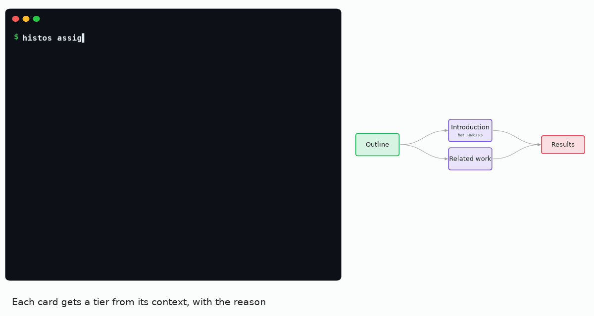
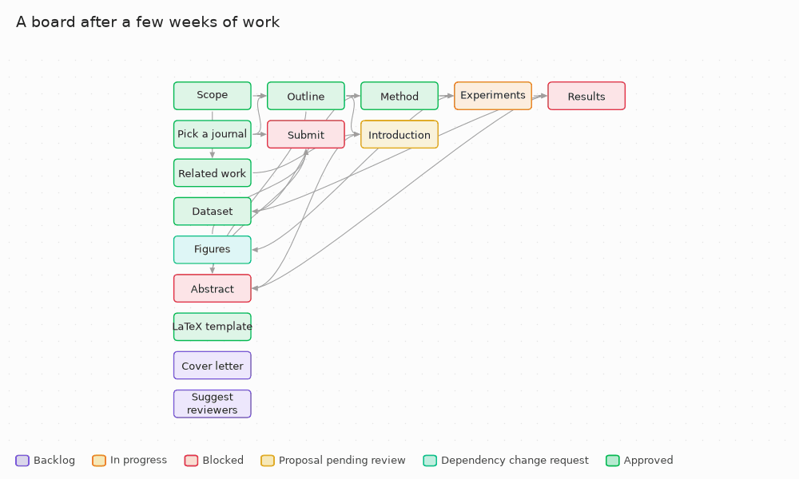

<h1 align="center">
  <picture>
    <source media="(prefers-color-scheme: dark)" srcset="docs/assets/histos-logo-dark.svg">
    
  </picture>
</h1>

Open-source, agent-agnostic tool that uses **Obsidian Canvas** as a shared human-AI board for managing projects with an AI agent: theses, papers, reports — and code.

The agent proposes the plan and drafts the work; the human approves real changes before they're applied. Each card gets a tier and a model the human approves, can be handed to a subagent with a clean context, and has to pass deterministic evals before it reaches review.



<sub>The v3 cycle on a sample paper. Every line in the terminal is real `histos` output — [`scripts/make_demo_gif.py`](scripts/make_demo_gif.py) runs the commands on a throwaway vault to draw it.</sub>

Installing: [docs/install.md](docs/install.md). Day-to-day use (terminal and desktop app, side by side): [docs/usage.md](docs/usage.md). **How to work with Histos** — card size, rhythm, subagents, working unsupervised: [docs/workflow.md](docs/workflow.md). What changed in each version: [CHANGELOG.md](CHANGELOG.md).

> **State:** latest release **[v3.0.0](https://github.com/AIAYN-creator/Histos/releases/tag/v3.0.0)**. A CLI with 19 commands ([`src/histos/`](src/histos/), tests green on Windows and Linux) over a formal vault format ([`src/histos/schema/`](src/histos/schema/)), dogfooded on real writing and code projects — Histos v3 itself was planned and reviewed card by card in a Histos vault — plus a desktop app for the human side ([`src/histos/gui/`](src/histos/gui/), downloadable as an `.exe`), alongside the terminal, not instead of it. What each version brought: [Roadmap](#roadmap). There is no Obsidian plugin — Histos writes to Obsidian's native Canvas (see below).

## Core idea

Strict separation between the **project map** (`project.canvas`) and the **actual content** (`.md` files). The canvas never contains prose — only file references, status metadata, and the dependency graph.

Everything lives locally, in a normal folder that you open as an Obsidian vault. There's no server or remote backend of its own — the only step that leaves your machine is the call to the agent/LLM.

## The two loops

### Loop 1 — Planning (the agent proposes the plan, the human authorizes the dependencies)

Through the CLI, the agent can on its own:
- Create standalone cards and give them a description and reference sources (`add-card`, `describe`)
- Pick up cards to work on (`assign`)

Requires explicit user authorization:
- Adding a **dependency** (`add-card --depends-on`, `link`) — because it redefines what unblocks what, and in what order, it's not a purely cosmetic change. The agent asks in the conversation first and only then passes `--authorized`.

The agent never edits `project.canvas` by hand and never moves cards: a card's position is set once, when it's created, and after that only the human moves cards — by hand in Obsidian, or with `histos arrange` (see [Canvas conventions](#canvas-conventions)).

In a freshly initialized vault (no cards yet), Loop 1 starts with a short interview — what the project is about, what type of work it is, whether there's a mandatory structure, whether review checkpoints should be modeled as cards — before proposing the initial card index. Full protocol in [`AGENTS.md`](src/histos/templates/AGENTS.md).

### Loop 2 — Execution (the agent works, the human decides)

1. The user says which card(s) to work on; the agent marks them In progress (`histos assign --worker <who>`)
2. The agent classifies the card (`histos classify`): a **tier** — `fast`, `exec` or `reasoning` — with the reason, from the card's description, dependencies and sources
3. The agent translates the tier into a concrete **model** of its platform and proposes it with that reason; the user approves it (or picks another), and only then is it recorded (`histos model --approved ... --authorized`). Histos never knows which models exist
4. The agent works the card itself, or hands it to a **subagent** that starts from zero with a self-contained brief (`histos context --for-subagent`)
5. The context for the draft comes from `histos context <id>`: the card's description and reference sources, the approved content of the cards it depends on, `PROJECT.md`/`ARCHITECTURE.md`, and the human's feedback if a previous proposal was rejected
6. The agent **never** writes directly to the canonical `.md` — it can only propose (`histos propose`). The proposal first goes through the vault's **evals**: if one fails (a leftover `TODO`, too short...) the card stays In progress and the agent fixes it, three attempts at most
7. A draft that passes moves the card to "proposal pending review"
8. The user reviews when they can (no need to be present while the agent works): `histos diff` shows which evals the proposal passed and in which attempt, then a before/after diff
9. The user approves (the real change gets applied, card → "approved") or rejects (the `.md` isn't touched; the card goes back to Backlog, with the optional feedback saved in its `status_note`, which `histos context` hands the agent on its next attempt)

**Key property — AFK-mode safety:** since the agent can only propose and never write directly, it's safe to leave it processing a queue of cards unsupervised *as long as the agent follows the rules in `AGENTS.md`*. Before leaving, the user approves the models for the queue in one go; while they're away the agent only works cards with an approved model. The worst case with an agent that follows the rules is finding yellow cards waiting for review, orange ones that ran out of attempts (with the reason written down), and untouched ones without an approved model — never real content written without authorization. Careful: much of this is a convention the agent complies with, not a technical barrier — see [Trust model](#trust-model).

How to organize the work around these loops — card size, decisions first, the review rhythm, when subagents pay off: [docs/workflow.md](docs/workflow.md).

### Dependency graph

Represented via the canvas edges as a DAG (directed acyclic graph). The agent respects topological order when choosing which card to work on next. If an action would break or ignore an existing dependency, the agent must flag it and ask for authorization **before** proceeding, never after. An arrow that a longer path already implies (A → B → C makes a direct A → C redundant) may be removed by `histos arrange` — the dependency itself isn't lost, it's kept in the card's `implied_dependencies` (see [Metadata](#metadata)).

## Tiers, models, subagents and evals

- **Tiers** come from heuristic rules in each vault's `histos.config.yaml`: a closed catalog of named conditions (`token_count >= 3000`, `code_blocks_present`, `architecture_terms_present`...), checked `reasoning` → `exec` → `fast`, first match wins, `exec` by default — deterministic and explained rule by rule, never a token prediction. The defaults were calibrated on ~400 real cards; `scripts/calibrate_tiers.py` measures any config against your own vaults.
- **Models** are proposed by the agent and approved by the human, card by card or a whole queue at once. Tiers are fixed (`fast`, `exec`, `reasoning`); the agent is what changes. For Claude Code, `AGENTS.md` suggests Haiku 5.5 / Sonnet 5.5 / Opus 5.5.
- **Subagents** get only what `histos context --for-subagent` gives them, propose their draft themselves, and return a short summary to the parent. A parent and its subagents can work at once: every command that changes the vault holds an OS file lock, and every file is written atomically.
- **Evals** are YAML files in `evals/`, run on every `propose`: `word_count`, `no_placeholders`, `required_headings`, `content_untouched`, each with `only`/`except` card id patterns. They filter obvious junk; the human still reviews everything that passes.

Format of all of it: [docs/canvas-schema.md](docs/canvas-schema.md). Using it day to day: [docs/usage.md](docs/usage.md).

## Trust model

The rules in [`AGENTS.md`](src/histos/templates/AGENTS.md) — never write to `content/*.md`, never pass `--authorized` without the human's yes, never run the human's commands (`approve`, `reject`, `retry`, `accept-edit`...), never touch `histos.config.yaml` or `evals/`, never run `histos arrange` unless asked — are a **prose convention**: they depend on the agent choosing to follow them. Histos backs some of them with real checks, and is honest about the rest.

**What's enforced for any agent:**
- **Direct writes to `content/` are detected.** Every legitimate write of a card's body (`add-card`, `approve`, the human's `accept-edit`) records a `content_hash`; the `content_untouched` eval fails every proposal while any card's body doesn't match it, whatever wrote it. It's detection, not prevention — but nothing written behind Histos's back reaches review unnoticed.
- **The vault format.** Cards can only point to files directly inside `content/`; `histos validate` and every command reject anything else (see [Canvas conventions](#canvas-conventions)).
- **Concurrent agents can't corrupt the vault.** The lock and atomic writes hold no matter which agent runs the commands.

**Claude-Code-specific enforcement:** `histos init` also installs [`.claude/settings.json`](src/histos/templates/.claude/settings.json) with `permissions.deny` (`Write` and `Edit`) covering `content/**`, `project.canvas`, `PROJECT.md`, `ARCHITECTURE.md`, `histos.config.yaml` and `evals/**`. Verified live: it blocks `Edit`, `Write`, and even `Bash` when the command references a denied path. `describe --sources` extends this: every time a source file is registered, its absolute path gets the same rules, so registered reference material (a Word doc, a `.tex` in Overleaf) gets the same protection as `content/`. The sync is add-only — it never removes a rule, so it can't silently undo something you added by hand. Older vaults pick up new rules the next time `describe` or `init --add-config` runs there.

Three honest limits:
1. **The deny list is Claude-Code-specific** — it doesn't protect you if the agent is another tool. Codex CLI and Gemini CLI have their own permission systems, in fundamentally different formats; neither is wired up by Histos yet (see [Future directions](#future-directions)).
2. **It's tool-level, not OS-level.** The agent and the CLI run as the same OS user, so an agent that ignores its instructions *can* run `histos approve` itself. The human-in-the-loop review is the real filter, by design.
3. **`describe --sources` doesn't require authorization**, by design (it's [`AGENTS.md`](src/histos/templates/AGENTS.md)'s "no permission needed" list) — so a misdirected agent could register a sensitive file as a "source" and read it through `histos context`. Closing it would mean requiring authorization for `describe --sources`, a workflow change bigger than a security patch.

This is a deliberate decision, not an oversight: the use case is a single user with a trusted agent that reads and follows instructions, and a human who reviews every change. It stops being sufficient if the agent isn't trustworthy (injected instructions, a misaligned model) or if several users with different interests share the same vault. A real, agent-agnostic guarantee would need OS-level separation — e.g. a container where `content/` is mounted read-only for the agent. That's **not planned**: for the way Histos is used, the human-in-the-loop review is enough, and OS sandboxing would make the tool much harder to set up.

## Canvas conventions

> Formal, machine-checkable schema: [`src/histos/schema/histos-canvas.schema.json`](src/histos/schema/histos-canvas.schema.json) — full detail of the whole vault format in [`docs/canvas-schema.md`](docs/canvas-schema.md).

- **Node types:** `file` — each card points to a real `.md` directly in `content/` (no `/`, `\` or `:` in its name), it never contains embedded text. `text` is used only for the decorative color legend that `histos init` generates (the CLI ignores it entirely). `group` shows up in two ways: the ones `histos arrange` creates and owns ("Not connected" and "Done", ids starting with `histos:`), and any you draw yourself in Obsidian, which Histos never touches.
- **Layout:** reads like a Gantt chart but without calendar dates — dependencies flow left to right, and every arrow leaves a card's right side and enters the next card's left side. A new card lands one column to the right of its dependencies, at their average height, in the nearest spot that doesn't overlap another node or sit on an existing arrow. Nothing else moves when that happens: `add-card` only places the card it creates, `describe` may resize a card to fit a new description but never repositions it, and `link` never touches position or size at all. The one command that moves existing cards is [`histos arrange`](#cli), which a human runs on purpose to re-lay out the whole board: dependency columns ordered to minimize crossings, a free corridor wherever an arrow skips over a column (so no arrow is ever drawn across a card), and two groups it owns — "Not connected" and "Done".



<sub>A sample project's board before and after `histos arrange`, rendered to match Obsidian's canvas (same colors, same arrow curves) — regenerate it with [`scripts/make_readme_gif.py`](scripts/make_readme_gif.py).</sub>

### Color legend

| Status | Color | Preset | Meaning |
|---|---|---|---|
| Backlog | purple | `"6"` | Pending task, not started yet |
| In progress | orange | `"2"` | The agent (or a subagent) or the user is working on it |
| Blocked | red | `"1"` | Can't start because it depends on a card that isn't approved yet (derived status, computed by the CLI) |
| Proposal pending review | yellow | `"3"` | The agent proposed content, it passed the evals, and it's waiting for approval |
| Dependency change request | cyan | `"5"` | Reserved for an agent waiting for authorization to change the dependency graph. No command sets it yet: in practice the agent asks in the conversation ([`AGENTS.md`](src/histos/templates/AGENTS.md) rule 4) before passing `--authorized` |
| Approved | green | `"4"` | Change accepted by the user and applied to the real content |

## Metadata

Whatever Obsidian/JSON Canvas doesn't natively interpret isn't forced into the `.canvas` — it's stored as **YAML frontmatter** at the top of each `.md`, a format Obsidian already shows as properties. This keeps the `.canvas` 100% compatible with standard Obsidian.

Fields: `description` and `sources` (set with `add-card`/`describe`), `assigned_to` and `worker` (set by `assign`), `status_note` (the feedback from `reject`, which `context` passes on to the agent), `implied_dependencies` (written by `arrange`), and the v3 fields: `proposed_tier` (`classify`), `proposed_model` and `approved_model` (`model`), `eval_results` (`propose`) and `content_hash` (every legitimate write of the body). `estimated_duration_hours` / `actual_duration_hours` are reserved, nothing sets them yet. Full table: [docs/canvas-schema.md](docs/canvas-schema.md#md-frontmatter).

## CLI

Concrete, clearly named commands instead of having the agent hand-edit the canvas JSON, to avoid breaking the format and to limit the agent to a known set of safe operations (like an API). Agent-agnostic: works with any tool that can run shell commands and read/write files (Claude Code, Codex, Gemini CLI...).

Installation (editable, for development):

```bash
pip install -e .
```

Every command operates on the current directory, which must be the root of a Histos vault (`histos init` creates it). No command blocks on an interactive prompt, so a queue of cards can be processed in AFK mode with a simple loop in the agent that invokes the CLI — no special flag or mode needed.

```bash
# --- the agent's commands ---
histos status                                           # cards by status, with tier, model and worker;
                                                          # models still waiting for approval; pending guides
histos add-card cap1 --title "Intro" [--description "..."]
                                                          # standalone card -> Backlog
histos add-card cap2 --title "Cap 2" --depends-on cap1 --authorized
                                                          # --authorized is required as soon as the dependency
                                                          # graph is touched -- a flag the agent only sets after
                                                          # asking for permission in the conversation
histos link cap1 --depends-on cap0 --authorized         # adds a dependency to an ALREADY existing card
histos describe cap1 --text "..." [--sources f1 f2]     # description and/or external sources (no permission needed)
histos assign cap1 [--worker NAME] [--takeover] [--by agent|human]
                                                          # -> In progress; refuses a card someone else has
histos classify cap1 [cap2...] | --all [--dry-run]       # tier (fast/exec/reasoning) and its reason
histos model cap1 --proposed "Sonnet 5.5"               # the agent's proposal
histos model cap1 [cap2...] --approved "..." --authorized
                                                          # the human's yes, recorded
histos context cap1 [--for-subagent]                    # everything to work the card (or a subagent's brief)
histos eval cap1 --file draft.md                        # runs the evals on a draft, spends no attempt
histos propose cap1 --file draft.md                     # evals first; if they pass -> Proposal pending review
histos guide propose PROJECT.md --file new.md           # proposes a change to PROJECT.md / ARCHITECTURE.md
histos diff cap1                                        # evals passed + diff against the pending proposal
histos validate                                         # canvas, frontmatter, config and evals

# --- the human's commands ---
histos init [--add-config]                              # new vault (canvas, content/, proposals/, approved/,
                                                          # config, evals, agent instructions) -- or bring an
                                                          # existing one to v3
histos approve cap1                                     # applies the proposal to the real .md -> Approved
histos reject cap1 [--feedback "..."]                   # discards the proposal -> Backlog, feedback in status_note
histos retry cap1                                       # 3 more attempts after the evals failed 3 times
histos accept-edit cap1 [cap2...]                       # accepts your own hand edits to a card's .md
histos guide approve|reject PROJECT.md [--feedback ".."]
histos arrange [--no-set-aside-done] [--no-prune-redundant]
                                                          # re-lays out the WHOLE board: dependency columns, no
                                                          # arrow across a card, "Not connected" and "Done" groups,
                                                          # redundant arrows removed; old layout -> project.canvas.bak
histos --version
```

### Opening the vault in Obsidian

`histos init` creates `project.canvas` in the current directory — that folder, **exactly that one and nothing above it**, is what you need to open as a vault in Obsidian (`Open folder as vault`). Canvas is a native Obsidian feature; no plugin needed.

Why this matters so much: cards reference their `.md` files with paths relative to the vault (`content/cap1.md`). If you open a folder above the one containing `project.canvas`, those paths no longer resolve and Obsidian shows cards as "Create new note" instead of with content — it's not broken, it's the wrong folder. If this happens after you already had the vault open correctly (e.g. because `histos` created files while Obsidian was already open), reload with `Ctrl+R` before suspecting anything else.

### Development

Code in [`src/histos/`](src/histos/) (commands in [`src/histos/commands/`](src/histos/commands/)), tests in [`tests/`](tests/) (`pytest`; `pytest -m "not slow"` skips the few that start real parallel processes — CI runs everything on Windows and Linux, Python 3.10 and 3.12). A complete sample vault: [`examples/sample-paper/`](examples/sample-paper/).

Scripts in [`scripts/`](scripts/), each runnable on its own and none touching your vaults:

- `make_example_vault.py` — rebuilds `examples/sample-paper/` by running the real `histos` commands.
- `make_demo_gif.py`, `make_readme_gif.py`, `make_logo.py` — the README's GIFs and logo.
- `calibrate_tiers.py` — how a tier config would split your vaults' cards (read-only).
- `stress_parallel.py` — several agents hammering a throwaway vault at once, then checks nothing was lost.
- `check_links.py` — every relative link in the README and `docs/` points somewhere real.

## Roadmap

Release by release: [CHANGELOG.md](CHANGELOG.md).

### v1 — shipped

- Formal `.canvas` schema with the color and node-type conventions above
- Frontmatter in the `.md` files for metadata Obsidian doesn't natively interpret
- Minimal CLI (Python, agent-agnostic): `init`, `add-card`, `link`, `describe`, `assign`, `context`, `propose`, `diff`, `approve`, `reject`, `status`, `validate`
- Non-interactive CLI mode for AFK work — solved: no command uses interactive prompts, no special flag needed
- Agent instructions documenting the schema, color legend, and the two loops' authorization rules — [`AGENTS.md`](src/histos/templates/AGENTS.md) (single source, agent-agnostic) + `CLAUDE.md` (one line, `@AGENTS.md`), which `histos init` copies into every new vault
- Real-write approval flow via diff before touching a canonical `.md`
- Dogfooding on a real thesis project

### v2 — shipped ([v2.0.0](https://github.com/AIAYN-creator/Histos/releases/tag/v2.0.0))

1. **Desktop app for non-technical use.** A `pywebview` window over `src/histos/operations.py` (a structured, non-printing extraction of the human-facing commands), packaged with PyInstaller (`packaging/histos-gui.spec`). The terminal isn't going anywhere — the desktop app is a second front end onto the same `operations.py`. Screens: pick a project folder (remembered) → offer to start one if it isn't a Histos project yet → a status overview (all 6 states, with the cards waiting for review front and center) → approve/reject with a plain-language before/after comparison. Buttons to open the vault in Obsidian (best-effort — Obsidian's own `open?path=` URI handling has [longstanding](https://forum.obsidian.md/t/starting-obsidian-from-command-line-with-uri-open-path-is-not-working-under-windows/107025) [reliability](https://forum.obsidian.md/t/obsidian-uri-doesnt-work-with-absolute-path-when-running-from-chrome-or-windows-10/73480) issues on Windows) or in the file explorer (always reliable). It doesn't launch or manage agent sessions, so Histos stays agent-agnostic.
2. **Broader sandboxing convention** (tool-level, see [Trust model](#trust-model)): Claude Code's `permissions.deny` also covers `project.canvas`, and `describe --sources` auto-registers each source's absolute path.
3. **Security hardening pass.** Dependency scan (`pip-audit`, clean), no `subprocess`/`shell=True`/`eval`/`pickle`/unsafe YAML anywhere, the `js_api` bridge reviewed, and one risk deliberately left open — limit 3 in [Trust model](#trust-model). *Correction found in the v3 audit:* this pass stated that the schema's `^content/[^/]+\.md$` kept a card from pointing outside `content/`. On Windows it didn't — a backslash is a separator there too, so a hand-edited canvas could make `approve` write outside the vault. Fixed in 3.0.0 (see v3 below).
4. **Stable card layout.** `add-card`, `link` and `describe` never move or resize existing cards; a new card is placed by collision-avoidance.

### v2.1 — shipped ([v2.1.0](https://github.com/AIAYN-creator/Histos/releases/tag/v2.1.0), [v2.1.1](https://github.com/AIAYN-creator/Histos/releases/tag/v2.1.1))

- **`histos arrange`.** Born from a real 110-card board that had become unreadable: cards piled up in the first column, arrows frozen pointing up and down, and 643 cases of an arrow drawn across a card. It re-lays out the whole board on request — Sugiyama-style dependency columns, free corridors computed from the exact curve Obsidian draws (643 → 0 on that board, and 0 on every other real vault it was tried on), "Not connected" and "Done" groups, redundant arrows moved into `implied_dependencies`. Around it: arrows always go right side → left side, and new cards land next to their dependencies.
- **v2.1.1.** `histos context` shows the card's own rejection feedback; docs corrected to match the code.

### v3 — shipped ([v3.0.0](https://github.com/AIAYN-creator/Histos/releases/tag/v3.0.0))

Model routing by tier, subagents with an isolated context, and deterministic evals as a filter before human review — the agent still proposes, the human still approves. Planned, specified and reviewed card by card in a Histos vault.

- **Tiers and model approval:** `classify` (heuristic, explained, calibrated on ~400 real cards), `model --proposed` / `--approved --authorized`, `histos.config.yaml`.
- **Subagents:** `context --for-subagent`, `assign --worker`/`--takeover`, and safe concurrency — an OS file lock around every command that changes the vault, atomic writes, verified by a stress test (8 agents × 20 rounds, nothing lost) — v2.1.1 lost 2–4 of 8 simultaneous `assign`s.
- **Evals:** `evals/` with four checks, run on `propose`, three attempts, `retry`, `eval` as a dry run, results in `diff`.
- **Direct-write detection** with `content_hash`, and `accept-edit` for the human's own edits.
- **Guidance files:** `ARCHITECTURE.md`, and `guide propose/approve/reject` for it and `PROJECT.md`.
- **Upgrading:** `init --add-config` for existing vaults.
- **Polish and audit:** CI on Windows and Linux, the code and its comments in English, `cli.py` split into `commands/`, a sample vault, docs rewritten, and a security and test audit: the Windows path-traversal fix above, the vault lock refusing symbolic links, the desktop app only ever opening folders, and test coverage from 93 % to 97 %.

### v2.2 — future (not yet shipped)

- Addressing GUI bugs and implementing minor features identified during beta testing.

## Future directions

Ideas for later versions, none committed yet — roughly from most to least likely:

- **The desktop app catches up with v3:** each card's tier, model and evals on the overview; approving the models of a queue and the guide changes from the app; `retry` and `accept-edit` as buttons.
- **Calibrating tiers from real outcomes.** Every card already records its tier, approved model, attempts and approval; a `histos stats` could show, per tier and model, how often proposals pass the evals at the first attempt and get approved — and suggest rule changes from that, instead of from heuristics alone. The reserved duration fields fit here too.
- **More eval checks**, still deterministic: citation keys that resolve against a `references.bib`, links and images that exist, a maximum length per section, and — opt-in, for code projects — running the project's own test command on a proposal.
- **Permissions for other agents.** Generate the equivalent of the Claude Code deny list for Codex CLI and Gemini CLI from the same rules.
- **An MCP server** exposing the Histos commands as structured tools, so agents call them directly instead of through a shell — clearer for the agent, and a narrower surface than shell access.
- **Project presets:** `histos init --preset thesis|paper|code` with a matching card table template, `histos.config.yaml` terms and evals.
- **The cyan state, for real:** a `histos link --request` that records a dependency change request on the board, for the human to accept, instead of only asking in the conversation.
- **Publishing on PyPI** (`pip install histos-cli`) and desktop app builds for macOS and Linux.
- **A read-only Obsidian plugin** that shows tier, model and eval badges on the canvas cards (Histos keeps writing the native Canvas).
- **Several human reviewers** with roles — who can approve which cards.
- Still open from earlier versions: git as an optional history backend for the content, calendar/date-based scheduling, pulling external context automatically (e.g. Overleaf's `.tex` via its Git integration), `content/` subfolder conventions, and a translated desktop app.

## Distribution scope

What's published in this repo is the **tool** (CLI, desktop app, vault format, agent instructions, documentation) as an open-source project, with a ready-to-run `.exe` of the desktop app on the [Releases](https://github.com/AIAYN-creator/Histos/releases) page. Git/GitHub is not the version-history backend for each user's project content — that's outside Histos's scope and is each user's own decision.

## Prior art

- **Kanvas (XMihura)** — direct architectural reference. Same pattern but code-oriented: a prompt + Python CLI the agent uses to touch the canvas, plus the `.canvas` itself. No SaaS, no build step, agent-agnostic. Histos started from that pattern for writing projects, and v3 brings it back to code too.
- **claude-canvas (AgriciDaniel)** — reference only for the auto-layout algorithm (`dagre`) and the idea of visual zones/groups. Not the base architecture. Histos's own `histos arrange` ended up in that same family (a Sugiyama-style layered layout), written from scratch in plain Python so it adds no dependency.
- **JSON Canvas spec (jsoncanvas.org)** — the `.canvas` format is the open JSON Canvas standard, not Obsidian-proprietary. Available node types: `text` (embedded markdown), `file` (path to a real vault file), `link` (URL), `group` (a purely geometric container — a node "belongs" to a group only if its coordinates fall inside the group's rectangle; there's no `parent_id` in the data).

## Open questions

- **How much signal the tier heuristics can get from one-line card descriptions.** The calibration shows a reasonable split with visible misses; richer descriptions help, and calibrating from real outcomes (see [Future directions](#future-directions)) is the likely next step.
- **Project brief format — mostly resolved:** `PROJECT.md` (what) and `ARCHITECTURE.md` (how) are both included as-is, and change only through `histos guide`. Still open: whether a recommended structure for them would help agents more than free text.
- **Folder structure — partially resolved:** cards live in `content/<id>.md` (see [`docs/canvas-schema.md`](docs/canvas-schema.md)); additional subfolders like `content/drafts/` remain open.
