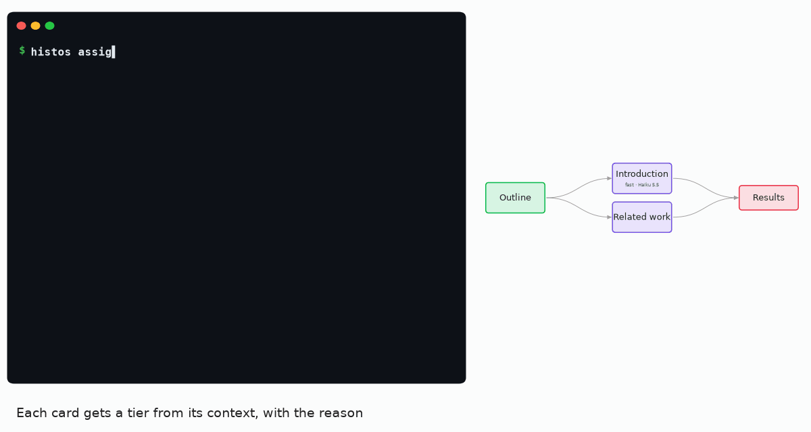
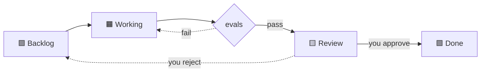
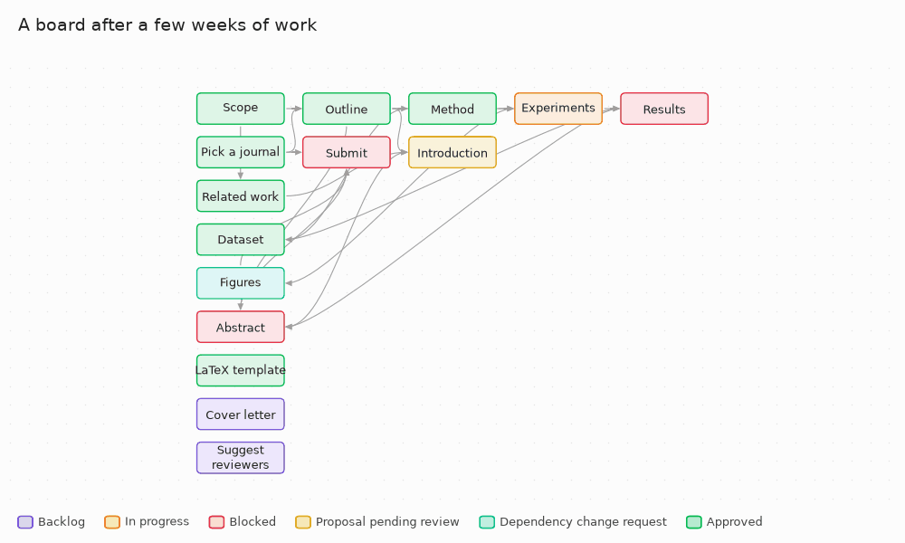

<h1 align="center">
  <picture>
    <source media="(prefers-color-scheme: dark)" srcset="docs/assets/histos-logo-dark.svg">
    
  </picture>
</h1>

<p align="center">
  <b>Your AI agent proposes. You approve.</b><br>
  A project board on Obsidian Canvas for working with AI agents on theses, papers, reports and code,
  where every change waits for your yes.
</p>

<p align="center">
  <a href="https://github.com/AIAYN-creator/Histos/releases/latest">Download</a> ·
  <a href="docs/install.md">Install</a> ·
  <a href="docs/usage.md">Usage</a> ·
  <a href="docs/workflow.md">Workflow</a> ·
  <a href="docs/roadmap.md">Roadmap</a>
</p>



<sub>Every line in the terminal is real `histos` output — [`scripts/make_demo_gif.py`](scripts/make_demo_gif.py) runs the commands on a throwaway vault to draw it.</sub>

## Why

Working with an agent on something long goes wrong in quiet ways: it rewrites a chapter you'd already settled, it loses track of what depends on what, and after an afternoon away you can't tell what it changed. Histos puts a board between you and the agent:

- 🗺️ **The plan is visible.** Every piece of work is a card in an Obsidian canvas, with arrows for what depends on what. The color tells you where it stands.
- ✋ **Nothing is written without you.** The agent never edits your content: it proposes a draft, and the change only happens when you approve it.
- 🧪 **Junk is filtered before you see it.** Each draft passes your evals first (no leftover `TODO`, the required sections, nothing edited behind Histos's back).
- 🧠 **The right model for each card.** Every card gets a tier (`fast`, `exec`, `reasoning`) with the reason, and you approve which model does it — or let a subagent take it with a clean context.
- 💻 **Local and agent-agnostic.** A plain folder and a CLI any agent can run (Claude Code, Codex, Gemini CLI...). No server, no plugin, no account.

## How it works



1. **You and the agent plan** the project: what it is, then the cards and their dependencies. Dependencies need your yes.
2. **The agent works a card** — itself or through a subagent — with everything it needs gathered by `histos context`.
3. **It proposes a draft.** The evals run; a failing draft goes back to the agent with the reason.
4. **You review when you can** — `histos diff`, or the desktop app — and approve or reject with feedback.

Because the agent can only propose, you can leave it working through a queue and come back to drafts waiting for you, never to content changed without permission. The full design: [docs/how-it-works.md](docs/how-it-works.md).

| | |
|---|---|
| **The agent does on its own** | create standalone cards, pick up work, classify tiers, propose models and drafts |
| **Needs your yes in the conversation** | adding a dependency, the model a card is worked with |
| **Only you** | `approve`, `reject`, `retry`, `accept-edit`, approving changes to `PROJECT.md` / `ARCHITECTURE.md`, `arrange` |

How much of this is enforced and how much is a rule the agent follows: [docs/trust-model.md](docs/trust-model.md).

## Quick start

```bash
git clone https://github.com/AIAYN-creator/Histos.git
cd Histos && pip install -e .

mkdir ~/my-thesis && cd ~/my-thesis
histos init                 # the board, the folders, the config and the agent's instructions
```

Open that folder in Obsidian (*Open folder as vault*) and `project.canvas` is your board. Then start your agent there and tell it what the project is: the `AGENTS.md` that `init` created teaches it the rest.

Prefer buttons for your side? The desktop app (`histos-gui.exe`, on the [Releases](https://github.com/AIAYN-creator/Histos/releases/latest) page) does reviewing and approving without a terminal. Step-by-step install, including Python and Obsidian: [docs/install.md](docs/install.md).

## The board

| Color | Status | |
|---|---|---|
| 🟪 purple | Backlog | ready to start |
| 🟧 orange | In progress | the agent or a subagent is on it |
| 🟥 red | Blocked | waiting for a card it depends on |
| 🟨 yellow | Pending review | passed the evals, waiting for you |
| 🟦 cyan | Dependency change request | reserved |
| 🟩 green | Approved | done |

The canvas only holds the map — the content lives in `content/<id>.md`, with its metadata as frontmatter Obsidian shows as properties. `histos arrange` re-lays out a messy board when you ask it to:



## Documentation

| | |
|---|---|
| [Install](docs/install.md) | Obsidian, Python, the CLI and the desktop app, step by step |
| [Usage](docs/usage.md) | the day-to-day cycle, terminal and desktop app side by side |
| [Workflow](docs/workflow.md) | how to work well with Histos: card size, rhythm, subagents, leaving it alone |
| [How it works](docs/how-it-works.md) | the full design: loops, tiers, models, evals, the board |
| [Commands](docs/cli.md) | every command, the agent's and yours |
| [Vault format](docs/canvas-schema.md) | the canvas, frontmatter, config and evals, with their schemas |
| [Trust model](docs/trust-model.md) | what's enforced, what's convention, and the honest limits |
| [Roadmap](docs/roadmap.md) | what's next, what shipped, future ideas and prior art |
| [Changelog](CHANGELOG.md) | every release in detail |

## Roadmap

| Version | | |
|---|---|---|
| **v3.0** | ✅ shipped | tiers and model approval, subagents, evals, safe concurrency |
| **v3.1** | 🔨 in development | a stricter project interview, plans reviewed as a whole, an event log from day one |
| **v3.2** | 📋 planned | time estimates from your own history; the critical path drawn on the canvas |
| **v3.3** | 📋 planned | project metrics and a final report with a Gantt chart and a PERT |
| **v4.0** | 📋 planned | yolo mode: agents build *and* review the whole backlog, on a separate branch |

Details and the ideas beyond: [docs/roadmap.md](docs/roadmap.md).

## Development

Code in [`src/histos/`](src/histos/), tests in [`tests/`](tests/): `pytest` runs everything, `pytest -m "not slow"` skips the few that start real parallel processes. CI runs on Windows and Linux, Python 3.10 and 3.12. A complete sample vault: [`examples/sample-paper/`](examples/sample-paper/).

Scripts in [`scripts/`](scripts/), none of which touch your vaults: `make_example_vault.py` (rebuilds the sample vault with the real commands), `make_demo_gif.py` / `make_readme_gif.py` / `make_logo.py` (this page's images), `calibrate_tiers.py` (how a tier config would split your cards), `stress_parallel.py` (several agents hammering a throwaway vault) and `check_links.py` (no broken link in the docs).

Histos is open source under the [MIT license](LICENSE).
