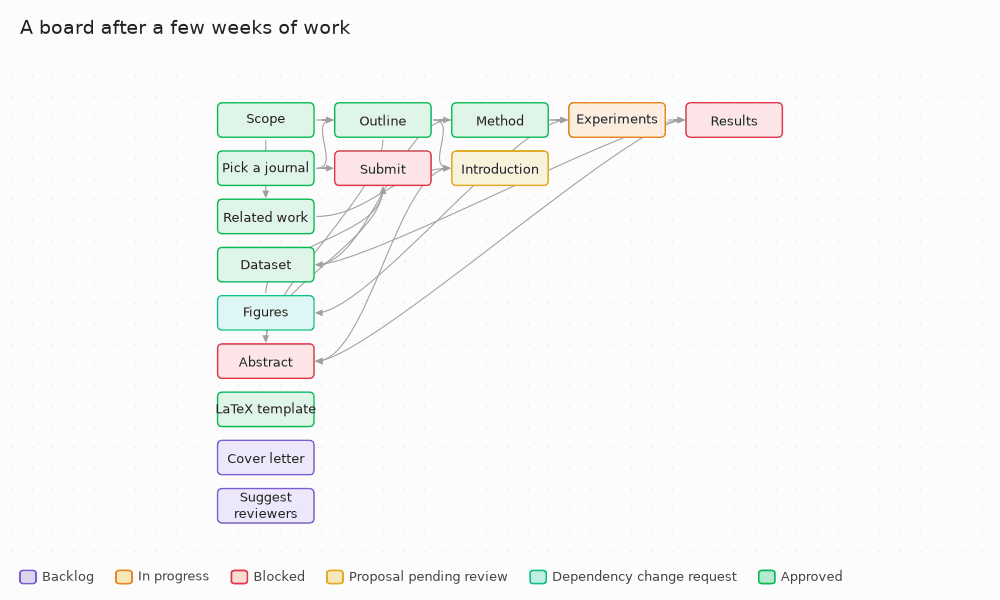

# How Histos works

The design in full: the two loops, the dependency graph, tiers and models, the board and its metadata. For the day-to-day version see [usage.md](usage.md); for how to organize the work, [workflow.md](workflow.md); for the exact file formats, [canvas-schema.md](canvas-schema.md).

## Core idea

Strict separation between the **project map** (`project.canvas`) and the **actual content** (`.md` files). The canvas never contains prose — only file references, status metadata, and the dependency graph.

Everything lives locally, in a normal folder that you open as an Obsidian vault. There's no server or remote backend of its own — the only step that leaves your machine is the call to the agent/LLM. There is no Obsidian plugin either: Histos writes Obsidian's native Canvas, an open format ([JSON Canvas](https://jsoncanvas.org/)).

## The two loops

### Loop 1 — Planning (the agent proposes the plan, the human authorizes the dependencies)

Through the CLI, the agent can on its own:
- Create standalone cards and give them a description and reference sources (`add-card`, `describe`)
- Pick up cards to work on (`assign`)

Requires explicit user authorization:
- Adding a **dependency** (`add-card --depends-on`, `link`) — because it redefines what unblocks what, and in what order, it's not a purely cosmetic change. The agent asks in the conversation first and only then passes `--authorized`.

The agent never edits `project.canvas` by hand and never moves cards: a card's position is set once, when it's created, and after that only the human moves cards — by hand in Obsidian, or with `histos arrange` (see [The board](#the-board)).

In a freshly initialized vault (no cards yet), Loop 1 starts with a short interview — what the project is about, what type of work it is, whether there's a mandatory structure, whether review checkpoints should be modeled as cards — before proposing the initial card index. Full protocol in [`AGENTS.md`](../src/histos/templates/AGENTS.md).

### Loop 2 — Execution (the agent works, the human decides)

1. The user says which card(s) to work on; the agent marks them In progress (`histos assign --worker <who>`)
2. The agent classifies the card (`histos classify`): a **tier** — `fast`, `exec` or `reasoning` — with the reason, from the card's description, dependencies and sources
3. The agent translates the tier into a concrete **model** of its platform and proposes it with that reason; the user approves it (or picks another), and only then is it recorded (`histos model --approved ... --authorized`). Histos never knows which models exist
4. The agent works the card itself, or hands it to a **subagent** that starts from zero with a self-contained brief (`histos context --for-subagent`)
5. The context for the draft comes from `histos context <id>`: the card's description and reference sources, the approved content of the cards it depends on, `PROJECT.md`/`ARCHITECTURE.md`, and the human's feedback if a previous proposal was rejected
6. The agent **never** writes directly to the canonical `.md` — it can only propose (`histos propose`). The proposal first goes through the vault's **evals**: if one fails (a leftover `TODO`, too short...) the card stays In progress and the agent fixes it, three attempts at most
7. A draft that passes moves the card to "proposal pending review"
8. The user reviews when they can (no need to be present while the agent works): `histos diff` shows which evals the proposal passed and in which attempt, then a before/after diff
9. The user approves (the real change gets applied, card → "approved") or rejects (the `.md` isn't touched; the card goes back to Backlog, with the optional feedback saved in its `status_note`, which `histos context` hands the agent on its next attempt)

**Key property — AFK-mode safety:** since the agent can only propose and never write directly, it's safe to leave it processing a queue of cards unsupervised *as long as the agent follows the rules in `AGENTS.md`*. Before leaving, the user approves the models for the queue in one go; while they're away the agent only works cards with an approved model. The worst case with an agent that follows the rules is finding yellow cards waiting for review, orange ones that ran out of attempts (with the reason written down), and untouched ones without an approved model — never real content written without authorization. Careful: much of this is a convention the agent complies with, not a technical barrier — see the [trust model](trust-model.md).

### Dependency graph

Represented via the canvas edges as a DAG (directed acyclic graph). The agent respects topological order when choosing which card to work on next. If an action would break or ignore an existing dependency, the agent must flag it and ask for authorization **before** proceeding, never after. An arrow that a longer path already implies (A → B → C makes a direct A → C redundant) may be removed by `histos arrange` — the dependency itself isn't lost, it's kept in the card's `implied_dependencies` (see [Metadata](#metadata)).

## Tiers, models, subagents and evals

- **Tiers** come from heuristic rules in each vault's `histos.config.yaml`: a closed catalog of named conditions (`token_count >= 3000`, `code_blocks_present`, `architecture_terms_present`...), checked `reasoning` → `exec` → `fast`, first match wins, `exec` by default — deterministic and explained rule by rule, never a token prediction. The defaults were calibrated on ~400 real cards; `scripts/calibrate_tiers.py` measures any config against your own vaults.
- **Models** are proposed by the agent and approved by the human, card by card or a whole queue at once. Tiers are fixed (`fast`, `exec`, `reasoning`); the agent is what changes. For Claude Code, `AGENTS.md` suggests Haiku 5.5 / Sonnet 5.5 / Opus 5.5.
- **Subagents** get only what `histos context --for-subagent` gives them, propose their draft themselves, and return a short summary to the parent. A parent and its subagents can work at once: every command that changes the vault holds an OS file lock, and every file is written atomically.
- **Evals** are YAML files in `evals/`, run on every `propose`: `word_count`, `no_placeholders`, `required_headings`, `content_untouched`, each with `only`/`except` card id patterns. They filter obvious junk; the human still reviews everything that passes.

## Estimates and the critical path

Each person trains their own Histos: estimates come from *their* closed cards, in all their vaults, recorded by the event log — never from the agent, which is bad at judging how long its own work takes. It's descriptive statistics, deterministic and explainable, like the tiers.

**Three times per closed card**, measured from the log:
- **agent** — time In progress being worked, over every round. *A worker does one thing at a time*: cards assigned in one batch before you leave (AFK) are worked one after another, so each round starts at the later of its assignment and that worker's last action on another card. Subagents are separate workers, so they do run in parallel. A takeover doesn't stop the clock.
- **review (calendar)** — every stretch waiting for your decision, nights included; also the wait for your `retry` after the evals ran out of attempts.
- **review (active)** — the same, minus the time you were away (`histos pause`, until your next decision).

Time in Backlog or Blocked counts for neither: it depends on what's ahead, not on the card. A card already under way when the log started gives no sample; one whose colors you changed by hand meanwhile is marked approximate.

**Two estimates per open card, grouped differently**, because they depend on different things:
- the **agent's** depends on the card: tier + type + dependencies (0 / 1 / 2+), then tier + type, then tier;
- the **review's** depends on you: type, then all your cards. It uses your *active* time.

A card's *type* is its id prefix (`dec-x` → `dec`, `cap3` → `cap`), only in vaults where at least two thirds of the cards share prefixes; otherwise there's no type. The first group with at least **5** closed cards wins, over its **30** most recent; the **median** is the estimate and the **80th percentile** (nearest rank) the "if it goes badly". Below 5 everywhere: "no data", and how many are missing.

**The critical path** is the remaining chain that takes longest: each open card weighs what it still needs (its estimate minus what it already has — in review, only the review), cards without an estimate weigh the median closed card, and with no closed cards at all every card weighs 1. It's drawn as magenta arrows and repainted after every command that changes the board. Histos notes the arrows it paints and only ever removes its own color, so an arrow you color is yours for good. Which review clock it counts (active or calendar) is a setting.

## The board

> Formal, machine-checkable schema: [`src/histos/schema/histos-canvas.schema.json`](../src/histos/schema/histos-canvas.schema.json) — full detail of the whole vault format in [canvas-schema.md](canvas-schema.md).

- **Node types:** `file` — each card points to a real `.md` directly in `content/` (no `/`, `\` or `:` in its name), it never contains embedded text. `text` is used only for the decorative color legend that `histos init` generates (the CLI ignores it entirely). `group` shows up in two ways: the ones `histos arrange` creates and owns ("Not connected" and "Done", ids starting with `histos:`), and any you draw yourself in Obsidian, which Histos never touches.
- **Layout:** reads like a Gantt chart but without calendar dates — dependencies flow left to right, and every arrow leaves a card's right side and enters the next card's left side. A new card lands one column to the right of its dependencies, at their average height, in the nearest spot that doesn't overlap another node or sit on an existing arrow. Nothing else moves when that happens: `add-card` only places the card it creates, `describe` may resize a card to fit a new description but never repositions it, and `link` never touches position or size at all. The one command that moves existing cards is `histos arrange`, which a human runs on purpose to re-lay out the whole board: dependency columns ordered to minimize crossings, a free corridor wherever an arrow skips over a column (so no arrow is ever drawn across a card), and two groups it owns — "Not connected" and "Done".

A sample project's board before and after `histos arrange`, rendered to match Obsidian's canvas (same colors, same arrow curves) — regenerate it with [`scripts/make_readme_gif.py`](../scripts/make_readme_gif.py).

### Color legend

| Status | Color | Preset | Meaning |
|---|---|---|---|
| Backlog | purple | `"6"` | Pending task, not started yet |
| In progress | orange | `"2"` | The agent (or a subagent) or the user is working on it |
| Blocked | red | `"1"` | Can't start because it depends on a card that isn't approved yet (derived status, computed by the CLI) |
| Proposal pending review | yellow | `"3"` | The agent proposed content, it passed the evals, and it's waiting for approval |
| Dependency change request | cyan | `"5"` | Reserved for an agent waiting for authorization to change the dependency graph. No command sets it yet: in practice the agent asks in the conversation ([`AGENTS.md`](../src/histos/templates/AGENTS.md) rule 4) before passing `--authorized` |
| Approved | green | `"4"` | Change accepted by the user and applied to the real content |

## Metadata

Whatever Obsidian/JSON Canvas doesn't natively interpret isn't forced into the `.canvas` — it's stored as **YAML frontmatter** at the top of each `.md`, a format Obsidian already shows as properties. This keeps the `.canvas` 100% compatible with standard Obsidian.

Fields: `description` and `sources` (set with `add-card`/`describe`), `assigned_to` and `worker` (set by `assign`), `status_note` (the feedback from `reject`, which `context` passes on to the agent), `implied_dependencies` (written by `arrange`), and the v3 fields: `proposed_tier` (`classify`), `proposed_model` and `approved_model` (`model`), `eval_results` (`propose`) and `content_hash` (every legitimate write of the body). `estimated_duration_hours` / `actual_duration_hours` are reserved, nothing sets them yet. Full table: [canvas-schema.md](canvas-schema.md#md-frontmatter).

## Opening the vault in Obsidian

`histos init` creates `project.canvas` in the current directory — that folder, **exactly that one and nothing above it**, is what you need to open as a vault in Obsidian (`Open folder as vault`). Canvas is a native Obsidian feature; no plugin needed.

Why this matters so much: cards reference their `.md` files with paths relative to the vault (`content/cap1.md`). If you open a folder above the one containing `project.canvas`, those paths no longer resolve and Obsidian shows cards as "Create new note" instead of with content — it's not broken, it's the wrong folder. If this happens after you already had the vault open correctly (e.g. because `histos` created files while Obsidian was already open), reload with `Ctrl+R` before suspecting anything else.
